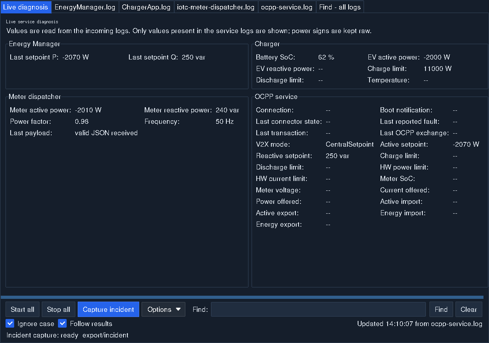

# Aperçus de l’interface RBM

Captures réelles de l’application en thème sombre, avec des données d’exemple
et sans connexion à une borne. Elles ont été prises sous Linux : la barre de
titre, l’icône et les polices natives Windows peuvent différer.

La disposition des commandes reste inchangée. Le thème clair reste disponible
via View → Theme. Les captures d’incident restent dans `export/incident`.

