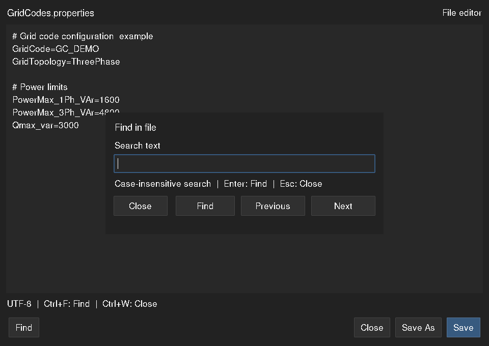
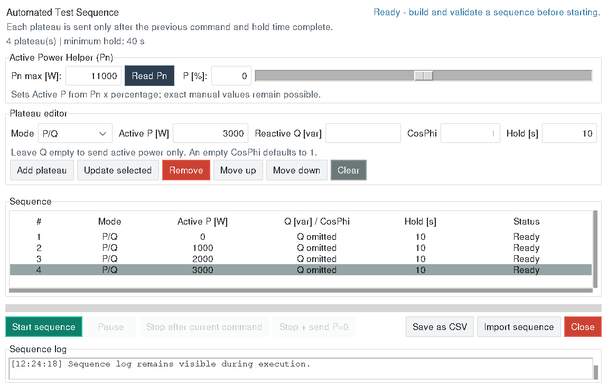
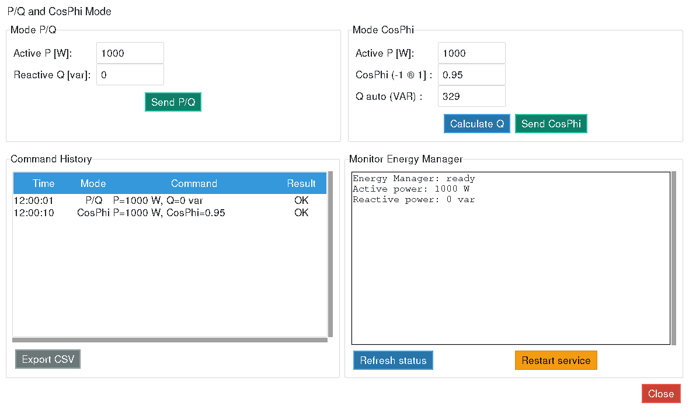
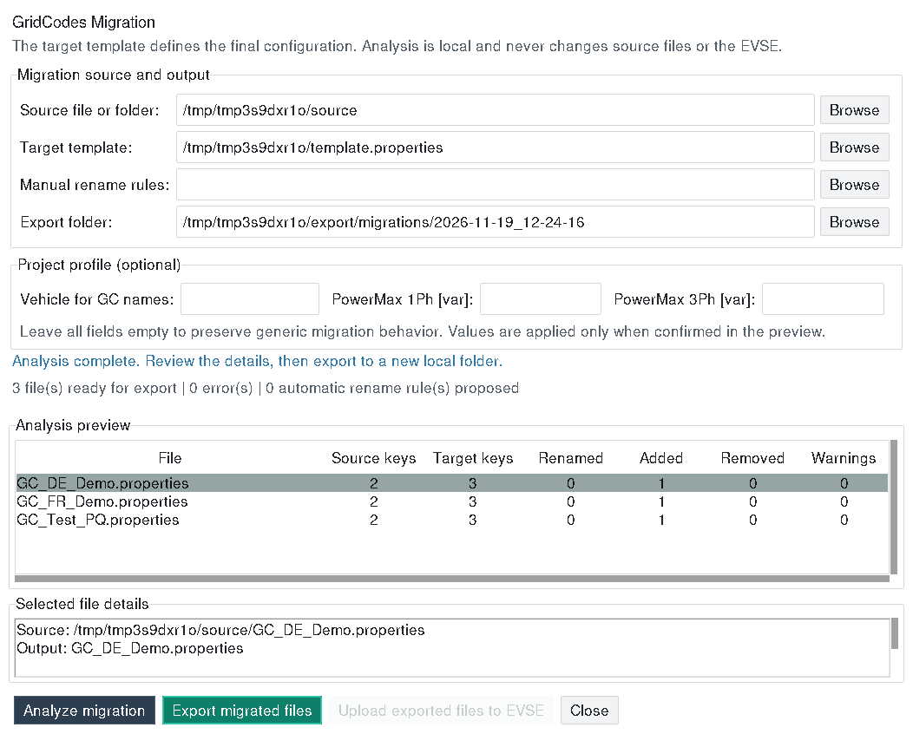

# Aperçus de l’interface RBM

Captures réelles de l’application en thèmes classiques Flatly et Darkly, avec des données d’exemple
et sans connexion à une borne. Elles ont été prises sous Linux : la barre de
titre, l’icône et les polices natives Windows peuvent différer.

La typographie utilise une police sans empattements installée sur le PC
(Segoe UI en priorité sous Windows), avec des titres sans gras.
Les configurations texte utilisent cette même police ; les scripts et logs
conservent une police monospace. Aucune installation de police supplémentaire
n’est nécessaire.

Les actions existantes sont conservées. Le thème clair reste disponible
via View → Theme. Les captures d’incident restent dans `export/incident`.

Le tableau des paliers reste dans une zone dédiée, hors du défilement des
réglages. La progression, les commandes et le journal restent fixes.

Titres secondaires compacts et zones de résultats réservées :

La version 17.1 rétablit les palettes classiques sélectionnées dans View → Theme,
sans substitution par une palette personnalisée. Les zones réservées au tableau,
à la progression, au journal et aux résultats restent conservées.
